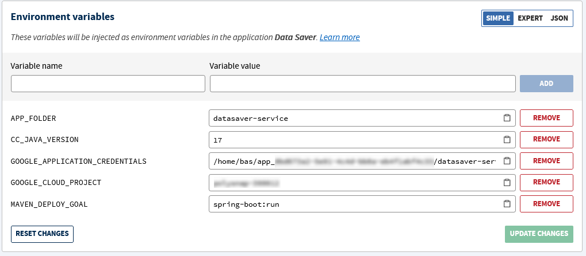

# Data Saver

## This project uses
- Maven 4.0.0
- Spring 3.1.3
- Java 17
- JDK 19
---

### Deploy the App on Clever Cloud

- Create a `Java + Maven` application named Data Saver
- Add the environment variables *(without the quotes)* needed:
  - APP_FOLDER="datasaver-service"
  - CC_JAVA_VERSION="17"
  - GOOGLE_APPLICATION_CREDENTIALS="/home/bas/`{Clever Cloud application id}`/datasaver-service/credentials.json" *(The application id can be retrieved from the information tab)*
  - GOOGLE_CLOUD_PROJECT="`{Name of the Google Cloud Project}`"
  - MAVEN_DEPLOY_GOAL="spring-boot:run"

  

- Link the `Data Saver` to the addon `Postgres DB` *(Service dependencies tab)*
- Add the Clever Cloud repository to your git remote *(Information tab)*
- Add the previously downloaded GCP `credentials.json` file in the datasaver-service folder
- Push the project to the remote

The app will build and deploy with each push done on the Clever Cloud remote
