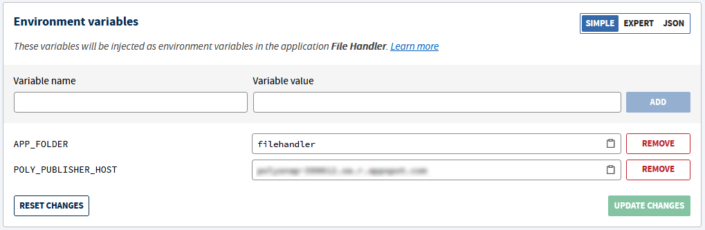

# File Handler

## This project uses
- NodeJS
---

### Deploy the App on Clever Cloud

- Create a `Node` application named File Handler
- Add the environment variables *(without the quotes)* needed:
  - APP_FOLDER="filehandler"
  - POLY_PUBLISHER_HOST="`{URL of the Publisher Service host}`"

  

- Link the `File Handler` to the addon `PolySnap S3` *(Service dependencies tab)*
- Add the Clever Cloud repository to your git remote *(Information tab)*
- Push the project to the remote

The app will build and deploy with each push done on the Clever Cloud remote

