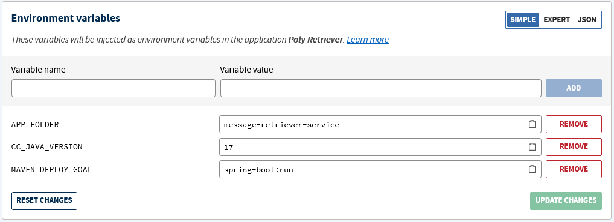

# Message Retriever

## This project uses
- Maven 4.0.0
- Spring 3.1.3
- Java 17
- JDK 19
---

### Deploy the App on Clever Cloud

- Create a `Java + Maven` application named Poly Retriever
- Add the environment variables *(without the quotes)* needed:
    - APP_FOLDER="message-retriever-service"
    - CC_JAVA_VERSION="17"
    - MAVEN_DEPLOY_GOAL="spring-boot:run"

  

- Link the `Poly Retriever` to the addon `Postgres DB` *(Service dependencies tab)*
- Add the Clever Cloud repository to your git remote *(Information tab)*
- Push the project to the remote

The app will build and deploy with each push done on the Clever Cloud remote
