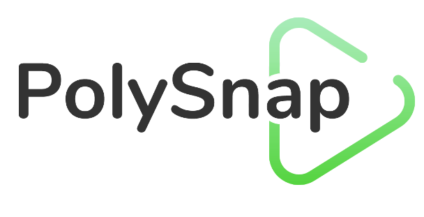
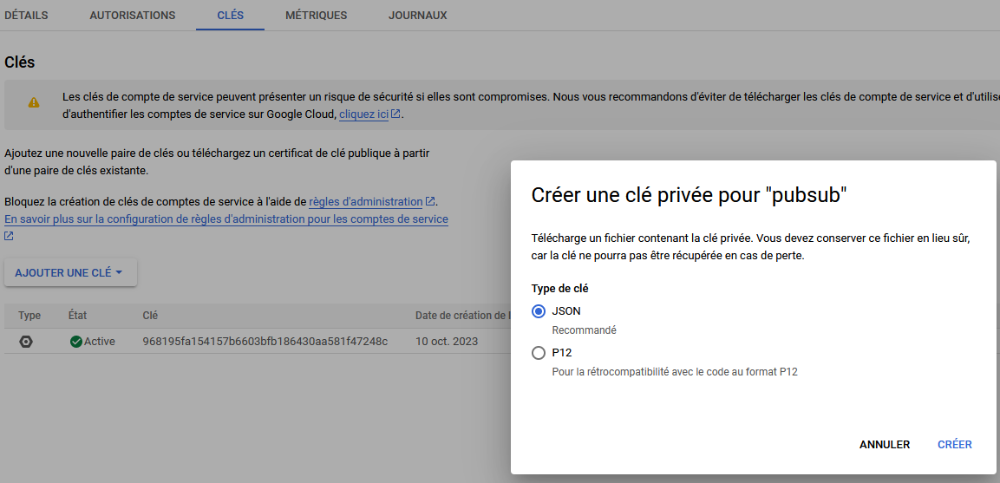
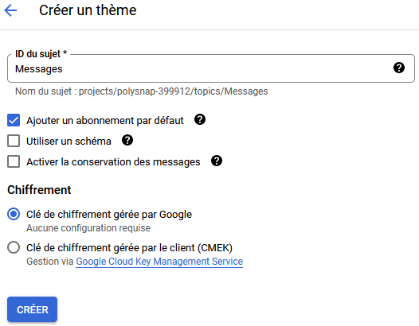

  

---

# Team A
## Authors
- [Antoine BUQUET](https://github.com/antoinebqt)
- [Benoit GAUDET](https://github.com/BenoitGAUDET38)
- [Ayoub IMAMI](https://github.com/AyoubIMAMI)
- [Mourad KARRAKCHOU](https://github.com/MouradKarrakchou)

---

### You can read the report [here](https://github.com/pns-si5-cloud/cloud-23-24-polysnap-a/blob/master/report.pdf)

---

## Requirements
- Git *(to clone the project and deploy it)*
---
## This project uses
- Maven 4.0.0
- Spring 3.1.3
- Java 17
- JDK 19
- NodeJS
---

## Code base

#### Directories
- *message-publisher-service*: Receives data from the front end, saves it in Cassandra and publishes it in Pub/Sub
    - Create, save and publish an account
    - Create, save and publish a chat 
    - Create, save and publish a message

- *datasaver-service*: Receives data from Pub/Sub and saves it in PostgreSQL
    - Receive and save an account
    - Receive and save a chat
    - Receive and save a message

- *message-retriever-service*: Retrieves data from PostgreSQL and sends it to the front end
    - Update in *"real time"* messages in a chat
    - Retrieve a chat between two users
    - Delete expired messages in the PostgreSQL database

- *filehandler*: Receives file from the front end, saves it in Cellar and sends its URL as normal message to the Publisher Service 
    - Manage pictures files
    - Manage videos files
    - Manage audio files

- *polysnap-front*: Front end of the application
    - Create an account
    - Log in
    - Create a chat
    - Send a message / file / GPS location
---

## Deployment protocols

You need first to create a Google Cloud project, activate some services and add some add-ons in order to deploy the rest of the project

### Google Cloud

- Create a new Google Cloud project
- Create a [service account](https://cloud.google.com/iam/docs/service-account-overview?hl=fr) for the future Pub/Sub via the Cloud Console
- Set the role of the service account to `Cloud Pub/Sub service agent`
- In the service account, create a new key and download it as a JSON file

  

This `credentials.json` file will be used later to connect the Pub/Sub service to the project

---
### Cassandra

- Select the Marketplace Cassandra named "*Apache Cassandra Cluster on CentOS Stream 9*"
- Connect to the Cassandra VM with SSH
- Verify that cassandra is running with `sudo systemctl status cassandra`
- If cassandra is not running, start it with `sudo systemctl start cassandra`
- Enter the Cassandra CLI with `cqlsh`
- Create namespace with `CREATE KEYSPACE IF NOT EXISTS keyspace_polysnap WITH REPLICATION = {'class' : 'SimpleStrategy', 'replication_factor' : 1};`

---
### Pub/Sub

- Activate Google's PubSub service in your Google Cloud project
- Create 3 topics (`Messages`, `Chats` and `Users`) and check `Add a default subscription`

  

---
### PostgreSQL add-on

- On Clever Cloud, create a new `PostgreSQL` add-on
- Choose at least the `XXS Small Space` plan
- Link any service to the add-on for the moment

---
### Cellar S3 storage add-on

- On Clever Cloud, create a new `Cellar S3 storage` add-on
- Choose the default `S` plan
- Link any service to the add-on for the moment

---
### Other services

After everything in the list above is set up, you can deploy the rest of the project *(you have to clone this repository first)*

- [Data Saver](https://github.com/pns-si5-cloud/cloud-23-24-polysnap-a/blob/master/datasaver-service/README.md)
- [Message Publisher](https://github.com/pns-si5-cloud/cloud-23-24-polysnap-a/blob/master/message-publisher-service/README.md)
- [Message Retriever](https://github.com/pns-si5-cloud/cloud-23-24-polysnap-a/blob/master/message-retriever-service/README.md)
- [File Handler](https://github.com/pns-si5-cloud/cloud-23-24-polysnap-a/blob/master/filehandler/README.md)

---

## Team members implication
|      Member       |  Point  |
|:-----------------:|:-------:|
|  Antoine BUQUET   |   100   |
|   Benoit GAUDET   |   100   |
|    Ayoub IMAMI    |   100   |
| Mourad KARRAKCHOU |   100   |
